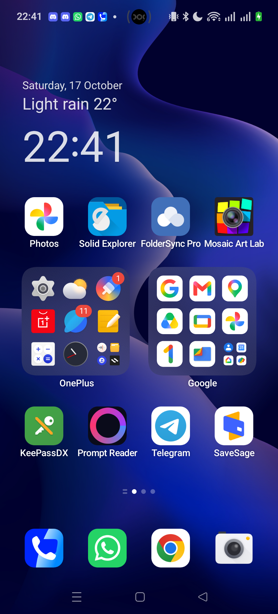

# App Inventory

A small Android app that lists every user-installed app and turns app bloat into
something you can act on.

- **Install / update date**, **first-ever usage**, **last used**, **launch count**, **storage** and **cache** for each app.
- A **summary strip** — Total / Never opened / Cleanup candidates / Reclaimable cache — each one a filter.
- A **storage bar** per row, scaled to the biggest app on the phone.
- **Kill-candidate highlighting** — apps that have never been opened, or were opened fewer than 5 times last used 90+ days ago.
- **One-tap "Uninstall"** (opens the system app-details page; OEMs that suppress the in-app uninstall dialog can't sabotage that).
- **CSV export**.

Single screen, offline, no account, no database (*scan on demand* — see below).



## Why a scan button

Launching the app never blocks. Tapping **Scan** does the heavy system queries
(PackageManager + UsageStats + StorageStats) on a background dispatcher, then
the list fills in. That scan is bounded — a few seconds on a 300-app phone —
and removable whenever you want fresh data. Uninstallating an app anywhere is
picked up automatically via an `ACTION_PACKAGE_REMOVED` receiver, so the list
stays in sync without a manual rescan.

## Tech stack

- Kotlin, Jetpack Compose (Material 3)
- AndroidX (Activity, Lifecycle, Core)
- JUnit4 (JVM unit tests) + AndroidX Test for instrumented smoke/UI tests
- Gradle (Kotlin DSL), min API 26, compile/target 35

Pure logic (kill rule, summary, sort/search/filter, CSV, bloat filter) lives in
`app/src/main/java/com/example/appinventory/logic/` with **no Android imports**,
so it's JVM-unit-tested. Data sources are behind interfaces (packages, usage,
storage), with fakes for tests and thin real-Android implementations.

## Permissions

- `PACKAGE_USAGE_STATS` (Usage Access) — enables launch count, last launch, storage and cache. The app still shows install dates without it.
- `QUERY_ALL_PACKAGES` + a `MAIN/LAUNCHER` query — needed to enumerate installed apps on Android 11+.

## Build

```
gradlew :app:assembleDebug
gradlew :app:testDebugUnitTest        # 19 JVM unit tests
gradlew :app:connectedDebugAndroidTest # 6 instrumented (needs a device, screen on)
```

`JAVA_HOME` plus Android SDK at `%LOCALAPPDATA%\Android\Sdk` (or set
`local.properties`'s `sdk.dir`). First Compose build downloads dependencies and
takes a while; subsequent builds are fast.

## Project layout

```
app/src/main/java/com/example/appinventory/
  data/      # AppEntry + source interfaces (packages, usage, storage) + repository
  logic/     # pure logic: Rules, Summary, SortSearch, CsvExport, BloatFilter
  ui/        # MainActivity, AppViewModel, InventoryScreen, AppRow, PermissionGate
app/src/test/...      # 19 JVM tests
app/src/androidTest/... # handful of instrumented smoke/UI tests
```

## License

MIT — see [LICENSE](LICENSE).
